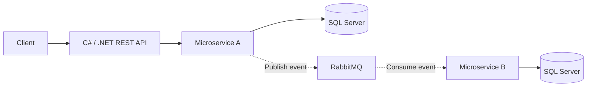
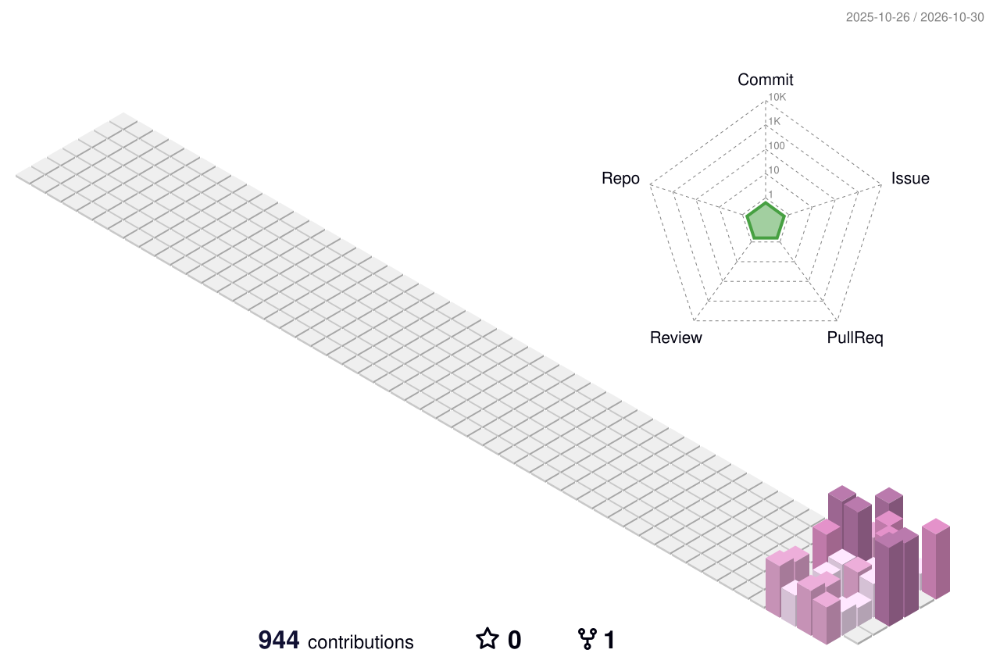

# Hi, I'm Filipe Andrade 👋

**Backend Software Developer · C# & .NET**

Microservices · Distributed Systems · Event-Driven Architecture

[GitHub](https://github.com/FilipeAndrade) · [LinkedIn](https://www.linkedin.com/in/filipedsandrade/)

---

### About me

I build backend applications with **C# and .NET**, working with **REST APIs**, **microservices**, and asynchronous messaging. My stack includes **RabbitMQ**, **NServiceBus**, **MassTransit**, **SQL Server**, and **Docker**.

### Tech stack

| Backend & APIs | Architecture & messaging | Data & infrastructure |
| --- | --- | --- |
| **C# · .NET · REST APIs** | **Microservices · RabbitMQ** | **SQL Server · Docker** |
| | **NServiceBus · MassTransit** | |

### How I connect systems

A conceptual view of the systems I work with:

Messaging with **NServiceBus or MassTransit**; applications packaged with **Docker**.

### My contributions, in 3D

<picture>
  <source media="(prefers-color-scheme: dark)" srcset="./assets/profile-3d-dark.svg" />
  
</picture>

### Follow the contribution snake

<picture>
  <source media="(prefers-color-scheme: dark)" srcset="./assets/snake-dark.svg" />
  
</picture>

The animations show a snapshot of my [GitHub contributions](https://github.com/FilipeAndrade?tab=overview) and refresh daily. They are not a measure of my full professional experience.

**Keep building. Keep learning. Keep improving.**

