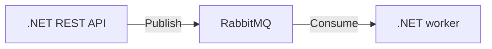

# Hi, I'm Filipe Andrade 👋

**Backend Software Developer · C# & .NET**

Microservices · Distributed Systems · Event-Driven Architecture

[Let's connect on LinkedIn](https://www.linkedin.com/in/filipedsandrade/)

---

### About me

I build backend services with **C# and .NET**, connecting **REST APIs** and **microservices** through asynchronous messaging.

### Tech stack

**Backend & APIs** · C# · .NET · REST APIs

**Architecture & messaging** · Microservices · RabbitMQ · NServiceBus · MassTransit

**Data & infrastructure** · SQL Server · Docker

### How I connect systems

A simple view of an asynchronous flow:

Messaging with **NServiceBus or MassTransit**, persistence in **SQL Server**, and services packaged with **Docker**.

### My contributions, in 3D

<picture>
  <source media="(prefers-color-scheme: dark)" srcset="./assets/profile-3d-dark.svg" />
  
</picture>

### Follow the contribution snake

<picture>
  <source media="(prefers-color-scheme: dark)" srcset="./assets/snake-dark.svg" />
  
</picture>

Activity visible on my [GitHub profile](https://github.com/FilipeAndrade?tab=overview), refreshed daily.
